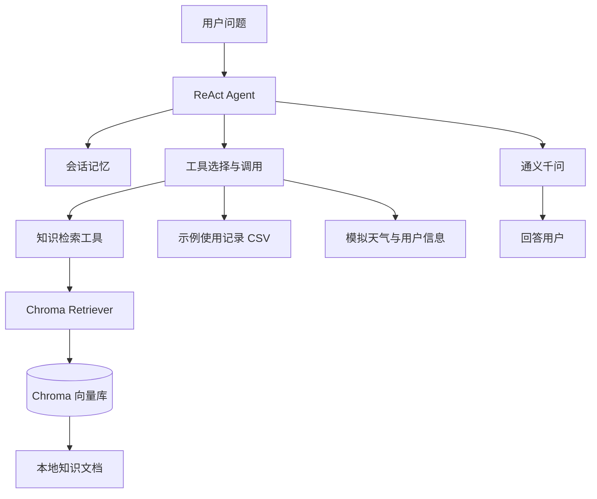

# 智净 Agent

一个面向扫地机器人与扫拖一体机器人的智能客服项目。项目使用 ReAct Agent 组织模型与工具调用，通过 Chroma 向量库检索本地知识，并支持进程内多轮对话记忆和可复现的检索评估。

> 当前项目定位为个人学习与实习准备项目。天气工具使用预设模拟数据，不提供实时天气；用户位置、用户 ID 和月份也是示例数据。

## 功能

- **领域知识问答**：将本地扫地机器人知识切分、向量化并存入 Chroma，回答时检索相关片段作为上下文。
- **ReAct 工具调用**：Agent 根据问题调用知识检索、天气、示例用户信息或本地使用记录等工具。
- **多轮对话记忆**：同一个 `session_id` 内保留最近 6 轮对话；CLI 支持 `/clear` 清空当前会话，`/exit` 退出。
- **报告场景提示词切换**：通过中间件处理工具调用和报告场景上下文。
- **检索效果评估**：以人工标注的相关来源为基准，对比不同 top-k 的来源召回率、命中率、平均检索耗时和空结果率。

## 技术架构



## 项目结构

```text
agent/
  conversation_memory.py   按会话保存最近几轮对话
  react_agent.py           Agent 初始化、流式执行与 CLI 入口
  tools/                   Agent 工具和中间件
config/                    模型、向量库、提示词和 Agent 配置
 data/                     扫地机器人知识文档及示例 CSV 数据
 evaluation/
  questions.json            检索评估问题与相关来源标注
  evaluate_retrieval.py     检索指标计算脚本
  results/                  逐题评估结果 JSON
model/                     通义千问聊天模型与 DashScope Embeddings 工厂
prompts/                   Agent 和 RAG 提示词
rag/                       向量库与 RAG 检索总结服务
utils/                     配置、文件、日志和路径工具
chroma_db/                 持久化 Chroma 向量库
```

## 环境要求

- Python 3.10 或更高版本
- DashScope API Key
- 可访问 DashScope 服务的网络

仓库目前没有锁定依赖版本的 `requirements.txt` 或 `pyproject.toml`。在项目根目录创建虚拟环境并安装主要依赖：

```powershell
python -m venv .venv
.\.venv\Scripts\Activate.ps1
python -m pip install --upgrade pip
python -m pip install "langchain>=1.0" langchain-community langchain-chroma langchain-text-splitters chromadb dashscope pyyaml pypdf
```

设置 DashScope API Key（仅对当前 PowerShell 窗口有效）：

```powershell
$env:DASHSCOPE_API_KEY = "你的 DashScope API Key"
```


## 运行

在项目根目录启动交互式 Agent：

```powershell
python -m agent.react_agent
```

运行后可直接输入扫地机器人相关问题。输入 `/clear` 清空当前会话记忆，输入 `/exit` 退出。

模型名称在 `config/rag.yml` 中配置，当前示例为 `qwen3-max` 和 `text-embedding-v4`。知识库与切分参数在 `config/chroma.yml` 中配置；Agent 和 RAG 提示词分别位于 `prompts/` 与 `config/prompts.yml`。

### 初始化或更新知识库

知识文档位于 `data/`，当前加载器支持 TXT 和 PDF。需要将新增或修改的文档写入向量库时，在项目根目录运行：

```powershell
python -c "from rag.vector_store import VectorStoreService; VectorStoreService().load_document()"
```

加载器使用文件 MD5 记录跳过已处理文档；向量库保存在 `chroma_db/`。评估和问答都依赖可访问的向量库。

## 多轮记忆验证

在 CLI 中依次输入：

```text
我家是木地板，家里有一只猫。
结合我刚才说的情况，选扫地机器人要注意什么？
/clear
我刚才告诉你家里是什么地板？
```

第二轮回答应能结合前文；清空记忆后，Agent 不应再把前文当作当前会话上下文。记忆保存在当前 Python 进程内，不会跨进程或重启持久化。

## 检索评估

运行评估脚本：

```powershell
python evaluation/evaluate_retrieval.py
```

问题集和人工标注来源位于 `evaluation/questions.json`。结果写入 `evaluation/results/retrieval_results.json`，包括每题召回详情及汇总指标。

当前仓库结果文件记录了 31 道问题的评估结果：

| Top-k | Source Recall@k | Hit@k | 平均检索耗时 | 空结果率 |
| ---: | ---: | ---: | ---: | ---: |
| 1 | 67.7% | 80.6% | 237.4 ms | 0.0% |
| 3 | 90.3% | 100.0% | 175.1 ms | 0.0% |
| 5 | 95.2% | 100.0% | 186.2 ms | 0.0% |

**指标说明**

- `Source Recall@k`：每道问题检索到的相关来源数除以该题标注的相关来源数，再对问题取平均。
- `Hit@k`：至少检索到一个标注相关来源的问题比例。
- `平均检索耗时`：检索调用的平均耗时，不包含聊天模型生成回答的时间；会受网络、缓存和运行环境影响。
- `空结果率`：检索结果为空的问题比例。

以上数字只反映当前知识库、31 道评估题和当前运行环境，不代表通用效果保证。增加、修改知识文档或评估标注后，应重新运行脚本并更新结果。

## 当前边界

- 天气工具是按城市名返回预设文案，不是实时天气 API。
- 城市、用户 ID 和月份采用示例默认值；外部使用记录来自 `data/external/records.csv`，不是生产用户数据。
- 对话记忆仅存在于进程内，当前按会话最多保留 6 轮。
- 检索评估集规模有限，且相关来源由人工标注；指标适合项目内对比，不宜外推到所有用户问题。
- 调用聊天模型和 Embeddings 需要有效的 DashScope API Key 与网络连接。
